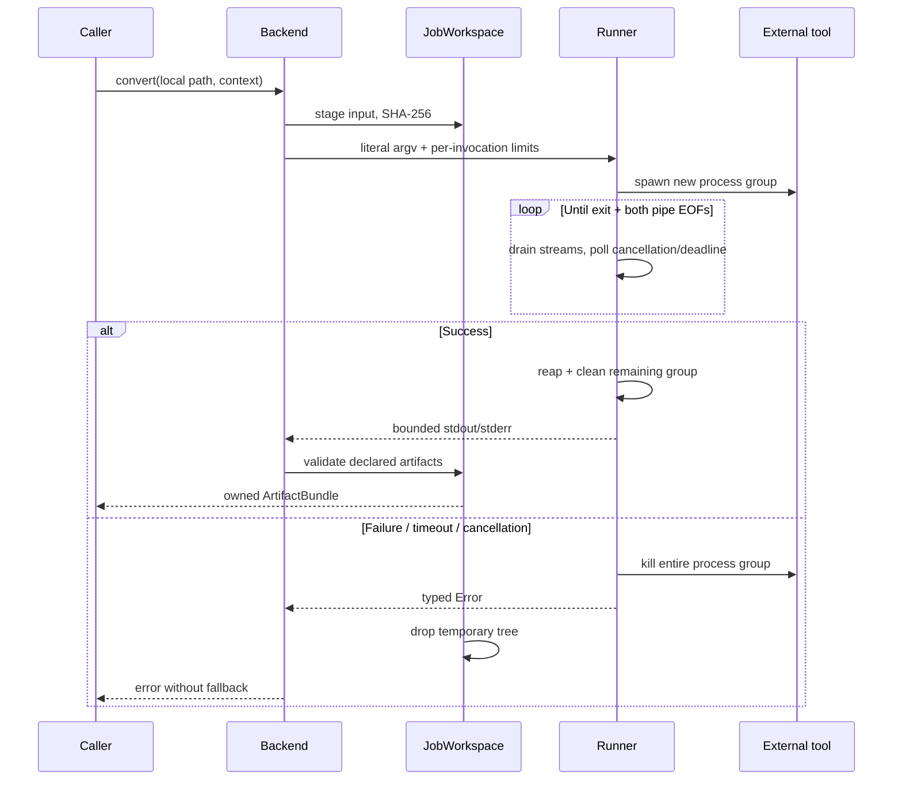
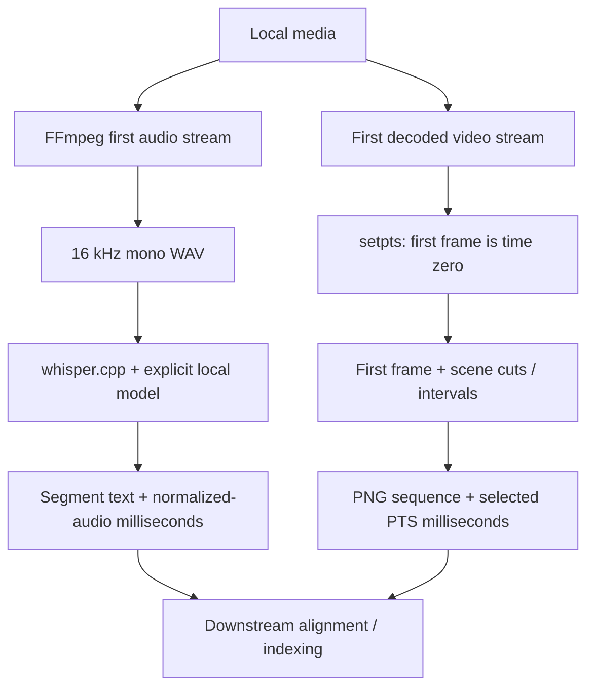

# Architecture

```mermaid
flowchart LR
    Caller[Caller / orchestrator] --> Registry[Explicit backend registry]
    Registry --> Backend[Configured Backend]
    Backend --> Stage[JobWorkspace: private source copy + hash]
    Stage --> Spec[Tool / literal CommandSpec]
    Spec --> Runner[Injectable Runner]
    Runner --> Process[Unix process group]
    Process --> Pipes[Bounded concurrent pipe capture]
    Process --> Files[Scratch artifacts]
    Pipes --> Parse[Contract parser]
    Files --> Validate[Containment + size + signature checks]
    Parse --> Manifest[Manifest: source + text + locations + diagnostics]
    Validate --> Manifest
    Manifest --> Bundle[ArtifactBundle owns workspace]
    Bundle --> Export[Explicit export]
    Bundle --> Documents[Caller invokes omniattach-documents]
```

No globally shared model manager, cache, GPU lock, process registry or async runtime is implemented. Each call owns its temporary data. Concurrency is controlled by the caller; use a bounded worker pool and separate `BackendContext` policies. Cloned cancellation tokens intentionally share cancellation state; cancellation is permanent for that token.

The registry maps an explicit backend ID to one configured instance. Register different `CustomBackend::name` values for multiple custom contracts. Built-ins have fixed IDs; duplicate registration is rejected. There is no trait-object downcasting or configuration serialization subsystem.

The manifest schema is `omniattach-backends/0.1`. Source hashes cover copied source bytes. Invocation metadata is diagnostic, not a reproducibility fingerprint: it omits argv, executable/model hashes, actual tool versions and most environment values. No stable cross-version output IDs or cache keys are promised. A production cache must include tool/model/options/build identities separately.
