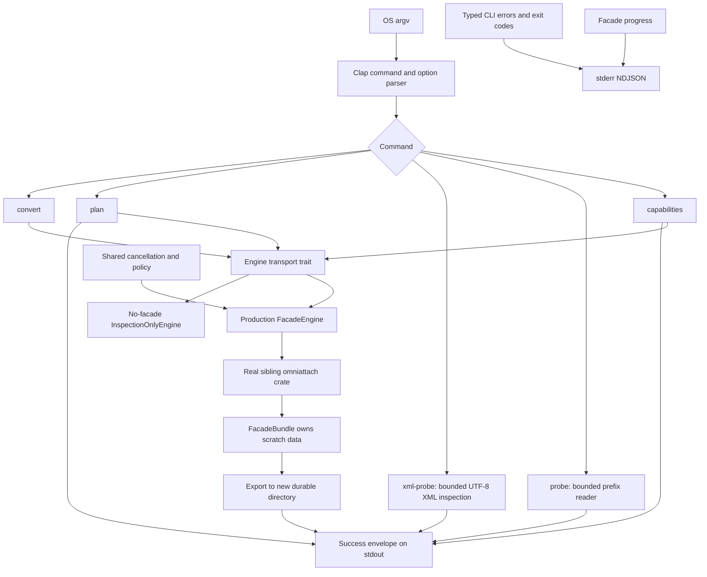
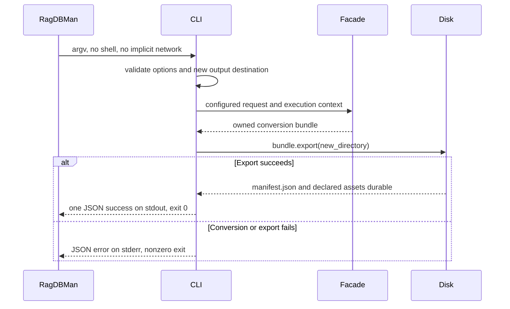

# CLI architecture

## Boundaries

`args.rs` owns argv. `service.rs` owns transport validation/dispatch and the Engine interface. `facade.rs` is the only dependency-specific production bridge. `probe.rs`/`xml.rs` provide inspection without pretending to perform document conversion. `runtime.rs` owns a lightweight cancellation facade; process main, not the library, installs global signal handling.

Only the real sibling facade may convert files. There is no hidden portable conversion copy or substitute core model in the CLI. Inspection-only binaries explicitly advertise `conversion_enabled: false`. The production default feature enables the sibling facade. The isolated verification manifest does not.

The capability output describes registered contracts, never installed tool health. Registering external contracts is separate from conversion permission. XML path statistics have their own versioned CLI schema; they do not claim equivalence to unpublished core XML types.
