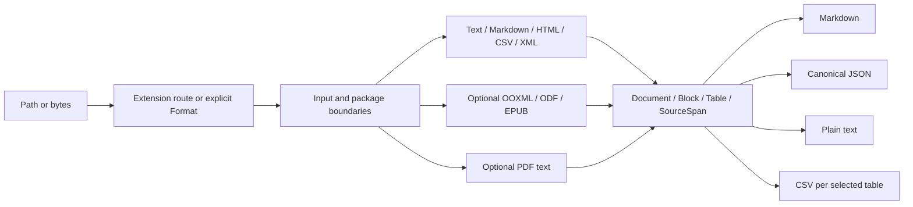
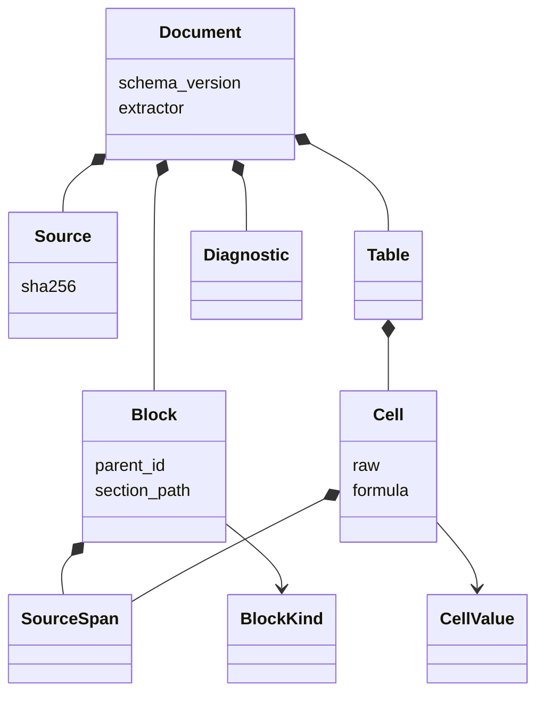

# Architecture

Models live in this crate because no core crate was supplied. A later workspace may move/re-export them through `omniattach-core`; schema migration will be required if contracts change. The current version deliberately does not invent an async engine, subprocess registry or asset store dependency.

`Document` is authoritative. Rendering never reparses Markdown to recover source positions. In particular, a table block references a canonical `Table`, rather than embedding a CSV/Markdown representation. Rendered text is a semantic projection, not a source-preserving roundtrip.

The public serializable model is early-stage. Extraction-local IDs, enum variants and schema `omniattach-documents/0.1` should be versioned by downstream stores. `extractor` records this crate version, not a complete transitive backend/build fingerprint; downstream caches must include their lockfile/build/options identity.

No implicit language/model inference, confidence score, generated summary or enrichment is attached. Everything is parser extraction; diagnostics describe limitations.
