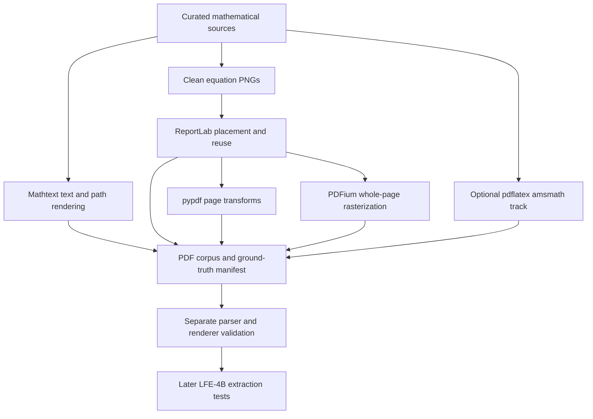

# LFE-STEP-4A: synthetic equation fixture foundation

## Scope

Adds test-generation tooling, independent parser/renderer validation, regression tests and artifact-producing CI. No Rust code, canonical schema, route, crate version, Cargo dependency or model changes. No OCR, recognition, merge or publication. All formulas/prose are synthetic and authored for these fixtures. Source LaTeX is in the external manifest, not deliberately embedded as an answer-bearing PDF field.

## Generate and validate

Python >=3.10; use an isolated environment. Direct dependency versions are pinned in the requirements file; this is not a full transitive lockfile. Generated files belong outside the checkout. The output directory must not already exist. A failed generation may leave a partial directory: remove it or choose a new destination before retrying. No downloads or package installation are performed by the generator itself.

```sh
python3 -m venv /tmp/lfe4a-venv
. /tmp/lfe4a-venv/bin/activate
python -m pip install -r scripts/requirements-lfe-equations.txt
python scripts/lfe_equation_fixtures.py /tmp/lfe-equations
python scripts/validate_lfe_equation_fixtures.py /tmp/lfe-equations
python -m unittest discover -s scripts -p test_lfe_equation_fixtures.py -v
```

The workflow generates and uploads the corpus as a CI artifact. PDFs and PNGs are intentionally generated rather than stored as encoded binaries in Git. GitHub Actions execution is not claimed by local verification.

## Baseline corpus

| PDF | Pages | Equation occurrences | Representation |
|---|---:|---:|---|
| native.pdf | 8 | 8 | Mathtext with embedded TrueType text, not a TeX compiler |
| outlines.pdf | 8 | 8 | Formula glyph outlines and rules as paths, no text-show operators |
| raster.pdf | 8 | 8 | One RGB equation XObject between synthetic prose |
| repeated.pdf | 1 | 2 | Same image XObject painted twice |
| transformed.pdf | 1 | 1 | Scaled image painted with a 90-degree placement rotation |
| page-transform.pdf | 1 | 1 | Non-default CropBox and page Rotate=90 |
| scanned.pdf | 8 | 8 | Full-page RGB rasters made by PDFium, with no text layer |
| negatives.pdf | 1 | 0 | Prose, code-like assignment and table-heading decoys |

Total: 8 PDFs, 36 pages, 36 equation occurrences, 8 clean equation PNGs. The 8 source expressions cover equality, fraction, nested fraction, root, integral, sum, limit and Greek sub/superscripts. Native and outline pages intentionally isolate one equation; raster pages provide surrounding prose. The negative assignment is a deliberate heuristic false-positive challenge, not an assertion that it cannot be interpreted mathematically.

## Optional full LaTeX track

```sh
python scripts/lfe_equation_fixtures.py /tmp/lfe-equations-advanced --latex
python scripts/validate_lfe_equation_fixtures.py /tmp/lfe-equations-advanced
```

Requires separately installed pdflatex plus geometry/amsmath/amssymb. Compiles only the curated repository expressions, with shell escape disabled and a per-invocation timeout. This is not a TeX sandbox and must not be generalized to untrusted user input. Adds latex.pdf with matrix, cases, aligned derivation and partial-derivative formulas: 9 PDFs, 40 pages and 40 occurrences overall. No automatic TeX installation. Baseline repeatability is tested; optional TeX byte reproducibility is NOT claimed. The toolchain version is recorded, but TeX packages and fonts are not comprehensively locked.

## Manifest and geometry contract

Schema: omniattach/lfe-equation-fixtures/0.1. Records original LaTeX, formula IDs, unique occurrence IDs, representation, one-based page, document/PNG SHA-256, font set, dependency versions and Python version. Repeated occurrences link to one formula identity but have distinct occurrence IDs.

bbox_pdf is an ALLOCATED REGION, not exact glyph/ink bounds. Coordinates are bottom-left, unrotated PDF default user space, in points. For these fixtures MediaBox is [0,0,612,792], UserUnit is default. The placement-rotated image gets an axis-aligned enclosing region. Page Rotate and CropBox do not change the stored coordinate convention. A production crop adapter must apply the actual page transform. The validator normalizes a copied page to MediaBox/Rotate=0 to check these coordinates; it separately checks the original transformed page renders. This does not verify a future production PDF-to-pixel adapter.

## Independent checks and limits

Generator layout supplies expected regions; it never obtains them from omniattach. A separate module uses pypdf parsing and PDFium rendering. It checks every file hash, page count, unique occurrence identity, formula references, region extent and nonblank region; all pages must render with nonwhite content. Structural checks distinguish native text/path formulas, repeated resource uses, full-page raster scans and CropBox/Rotate. Tests also check refusal to overwrite, byte equality across two baseline generations in different directories in the same environment, corrupted-byte rejection and wrong-region rejection. Do not run the validator with Python -O (explicitly rejected).

These are fixture-construction checks, not OCR accuracy, mathematical equivalence, exact ink-bound certification or Rust integration evidence. Nonblank regions are a sanity check, not proof that every glyph is inside the region. Same-environment byte repeatability is not a cross-platform guarantee. Synthetic scans are pristine renderings, not realistic camera/photocopy degradations.

Tagged formulas, inline prose/formula layouts, noisy/blurred scans, unusual UserUnit/MediaBox origins, multiline region detection, chemistry, model evaluation and equation reinsertion remain later work. They are not silently covered by this baseline.



## Local verification checkpoint

Baseline: 6 tests passed; optional pdflatex test skipped because compiler is not installed. The tested package versions are pinned in the requirements file. Same-environment byte-for-byte regeneration passed after using pixel-backed ReportLab image identities rather than absolute input filenames. No Rust toolchain is installed in the preparation environment; no Rust suite was executed and no Rust behavior changed. Optional TeX generation is implemented but not executed here. Run it on a provisioned TeX environment before relying on those advanced fixtures.
