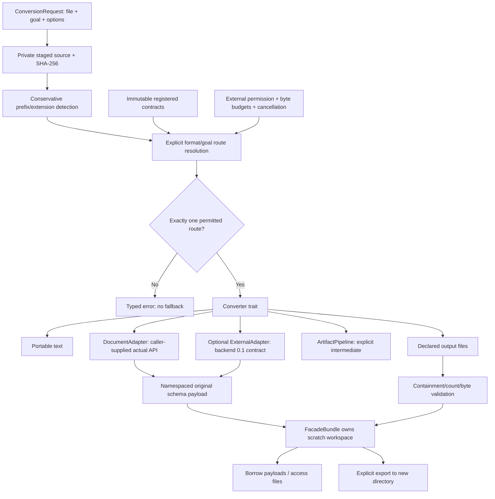
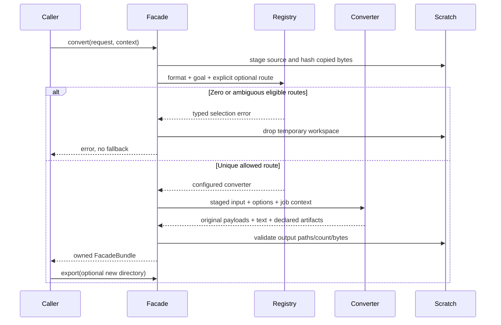
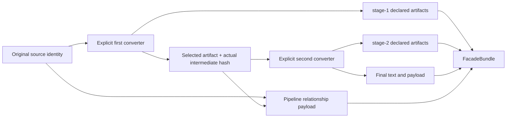

# Facade architecture

## Schema and compatibility

The facade envelope version is `omniattach/facade/0.1`. It holds source identity, route/goal/format, elapsed time, warnings, text fragments, payloads and owned artifact descriptors. Payloads are namespaced by the actual producer schema, not translated through guessed JSON fields. This avoids presenting an unpublished core/document schema as if it had been verified.

`omniattach::core`, `::documents` and `::backends` are optional sibling namespaces. The portable facade has its own route and progress contracts; these are not aliases for an uninspected core planner. The actual workspace should eventually consolidate planner/progress/types rather than maintain two canonical systems. No serialization equivalence is promised today.

A converter is configured once and must be Send + Sync. The facade engine is immutable after build, so multiple caller-controlled threads can share an engine. Every conversion has its own temporary directory. Concurrency scheduling, model loading, GPU access, backpressure, retry and task persistence remain caller/backend responsibilities.

## Portability

The portable facade uses filesystem/encoding operations without POSIX process APIs. Only Linux was tested. Optional subprocess platform guarantees come from the actual backend runner. A registered `ExecutionKind::InProcess` is a declaration by trusted application code, not runtime proof that a closure never starts a process.
